# Site Analytics

A private dashboard for job seekers who send employers to their own website. It reads your
Google Analytics, matches each visit to the jobs you applied to, and estimates who looked and
when. It also finds open jobs that fit you and suggests someone to reach out to about each one.

It runs on your own computer. Your applications, contacts and notes never leave it.

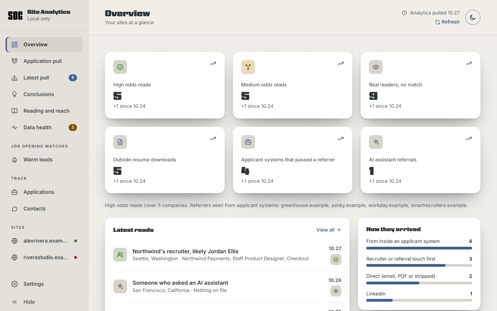

Every screenshot here comes from the built-in demo. The people, companies and websites in it are
made up.

## What it does

**Application pull.** Each reader of your site, scored against your applications and contacts.
High odds means the visit came from inside an applicant system, or within hours of a call or a
referral, from a place that fits the job. Every name is an estimate: Google Analytics never names
a person or a company.

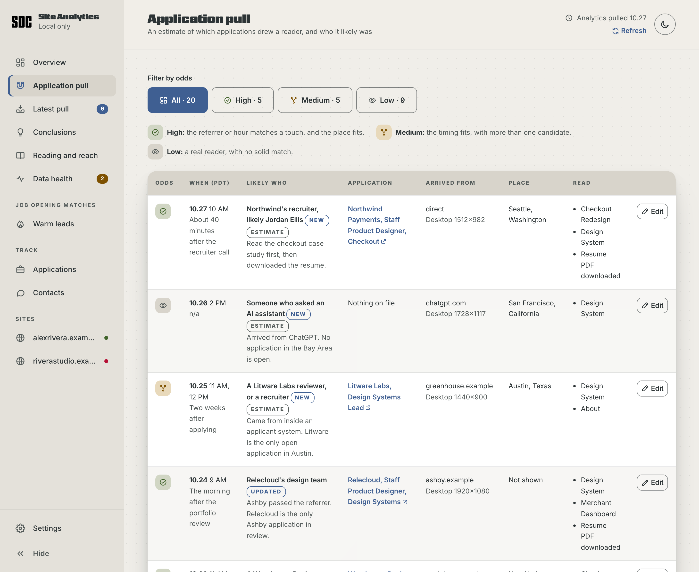

**Warm leads,** under Job opening matches. The app checks the public job boards of companies you
have applied to (Greenhouse, Lever, Ashby, Workday and SmartRecruiters) once a day. It keeps the
jobs whose title, seniority, location and pay fit what you asked for, best match first, and shows
who you know there.

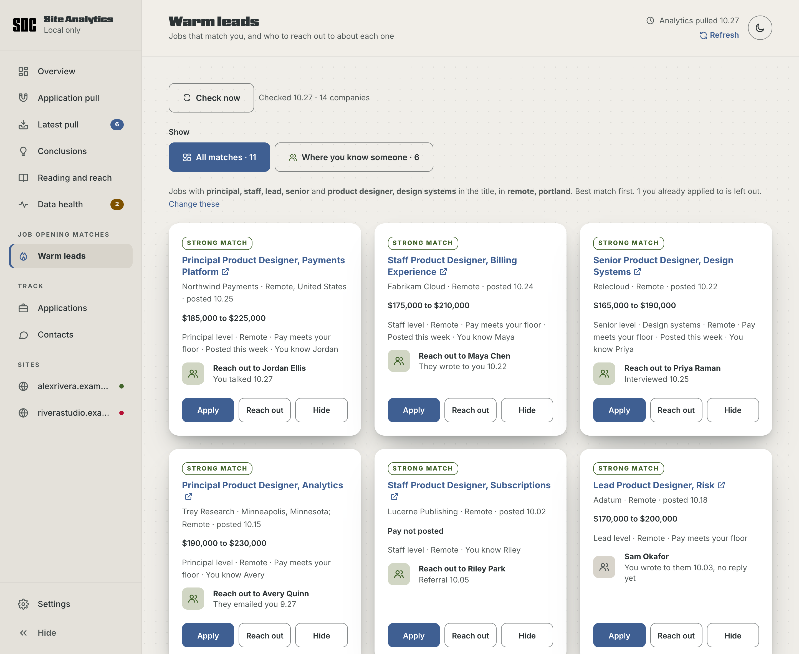

**Reach out** finds people at the company on LinkedIn and writes a short note from your own
template. You copy the note and send it yourself. The app never sends anything for you.

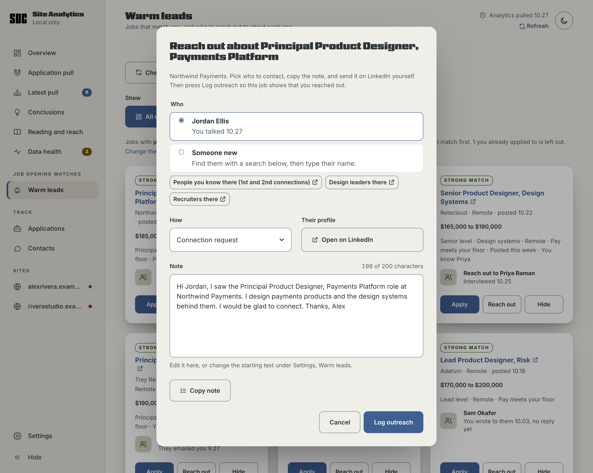

Also in the app:

- **Latest pull:** what came in over the last 7 days, and what was filtered out (your own visits,
  machines and spam).
- **Reading and reach:** which pages people read, how they arrived, and where they read from.
- **Data health:** a check of each website's Google Analytics setup, with a link to each fix.
- **Applications** and **Contacts:** the lists the odds are scored against. Paste a job link and
  the company, role, requisition number and places fill in.
- Light and dark themes.

<table>
<tr>
<td>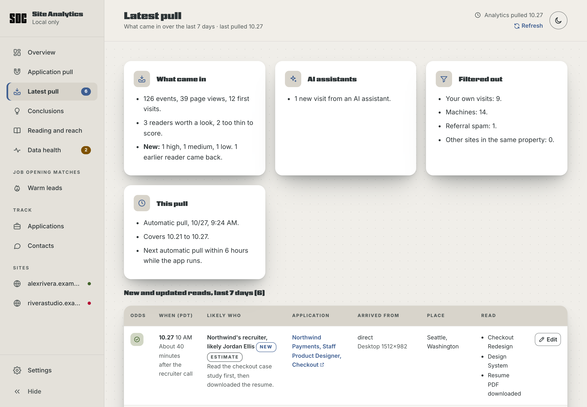</td>
<td>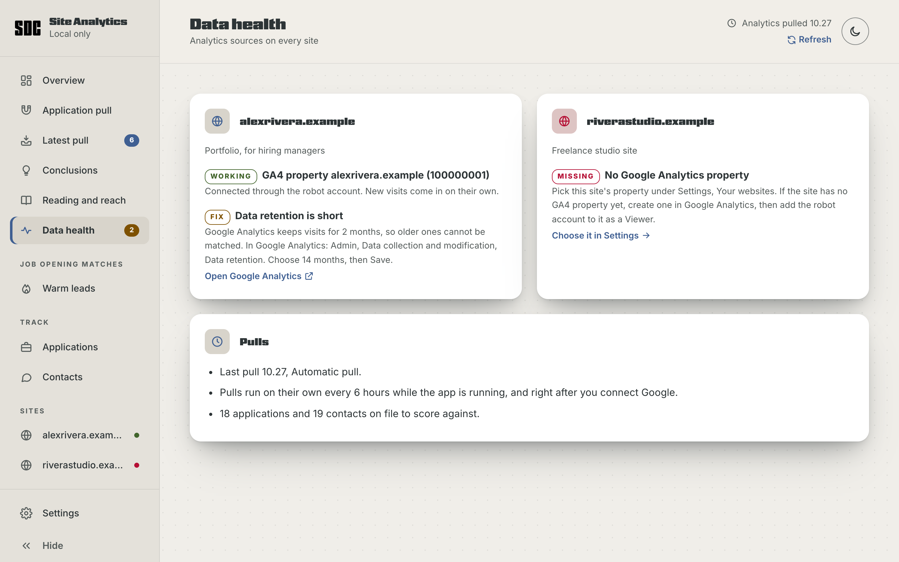</td>
</tr>
<tr>
<td>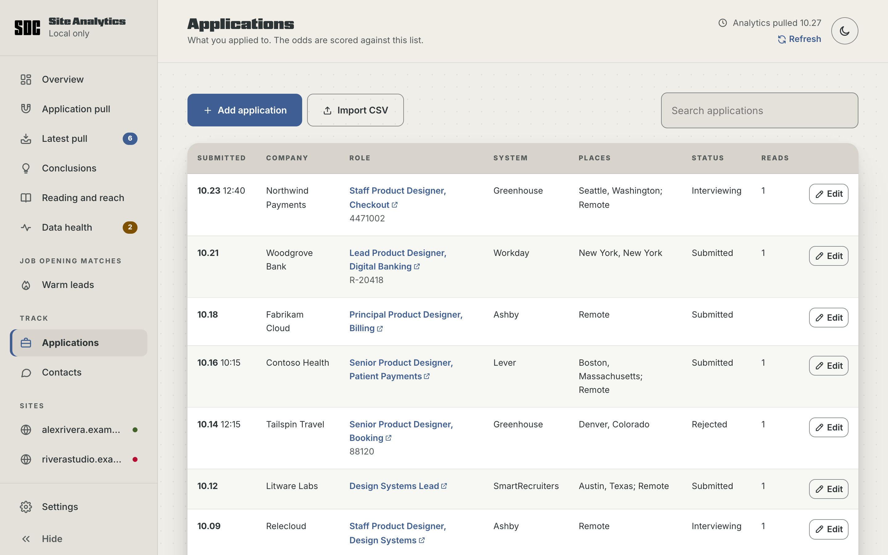</td>
<td>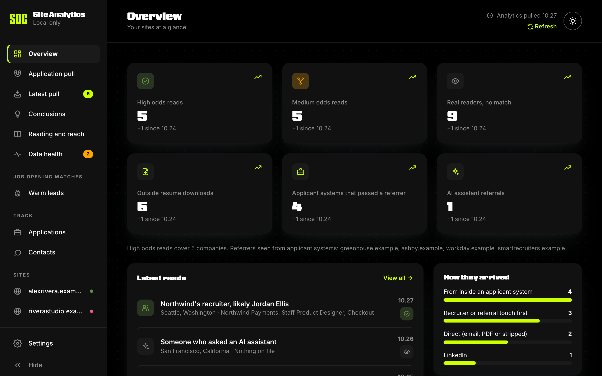</td>
</tr>
</table>

## What you need

- A Mac. The app is built and tested on macOS. It should run on Windows and Linux too, but the
  start at login script is Mac only.
- **Node.js 20 or later.** Free from [nodejs.org](https://nodejs.org) (pick the LTS version).
  There is nothing else to install.
- A website with **Google Analytics 4** on it, and a sign-in to that Google Analytics account.
  The app does not add Google Analytics to your site.
- About 15 minutes for the first setup.

## Install

### The easy way: ask Claude

If you use [Claude Code](https://claude.com/claude-code), paste this prompt and it does the
install for you. [INSTALL-WITH-CLAUDE.md](INSTALL-WITH-CLAUDE.md) explains each step.

```text
Install the Site Analytics app for me from https://github.com/vandy1690/site-analytics.

1. Check that Node.js 20 or later is installed (node -v). If it is missing or older, tell me how to install the LTS version from nodejs.org, and wait for me.
2. Put the app in a folder named site-analytics in my home folder. Use git clone if git is installed. Otherwise download the ZIP of the main branch and unzip it there.
3. Read README.md and CLAUDE.md in that folder before doing anything else.
4. Start the app with "node server.mjs" from that folder, and open http://localhost:4340/ in my browser.
5. Ask me if the app should start on its own when I log in. Only if I say yes, run "scripts/login-item.sh install" (Mac only). If I say no, tell me the command to start it again later.
6. Then stop. The app walks me through the rest of the setup itself. Do not create Google Cloud projects, keys or accounts for me, and do not open, copy or change anything in the store or config folders.
```

### By hand

1. Install Node.js 20 or later from [nodejs.org](https://nodejs.org).
2. Get the app. Either run `git clone https://github.com/vandy1690/site-analytics.git ~/site-analytics`,
   or on GitHub click **Code**, then **Download ZIP**, unzip it, and move the folder to your home
   folder as `site-analytics`.
3. Open Terminal and run:

   ```sh
   cd ~/site-analytics
   node server.mjs
   ```

4. Open [http://localhost:4340/](http://localhost:4340/) in your browser.

Leave Terminal open while you use the app. To stop it, press Control C in Terminal.

## First run

The first time it opens, the app asks five things: your name and city, the jobs you want, your
websites, and then it hands you to the Google Analytics setup. Everything can be changed later in
Settings.

<table>
<tr>
<td>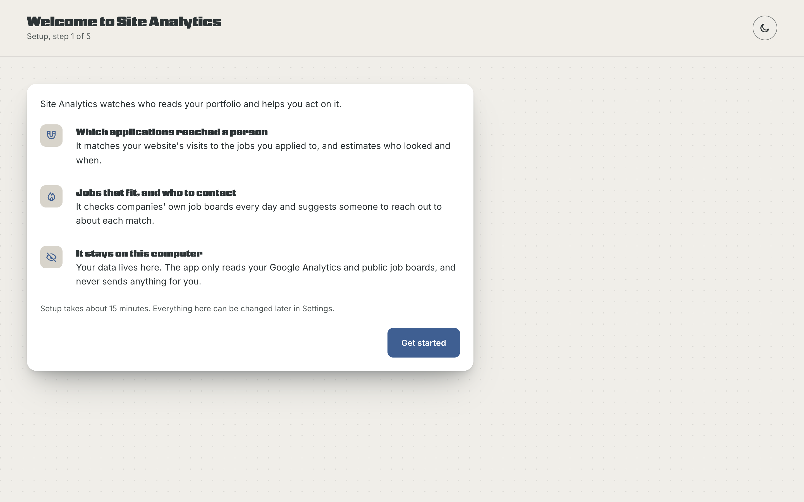</td>
<td>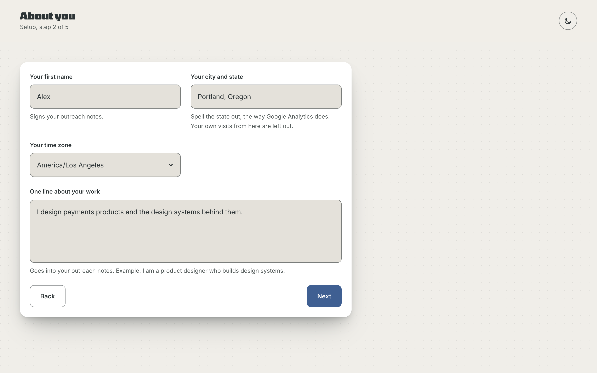</td>
</tr>
<tr>
<td>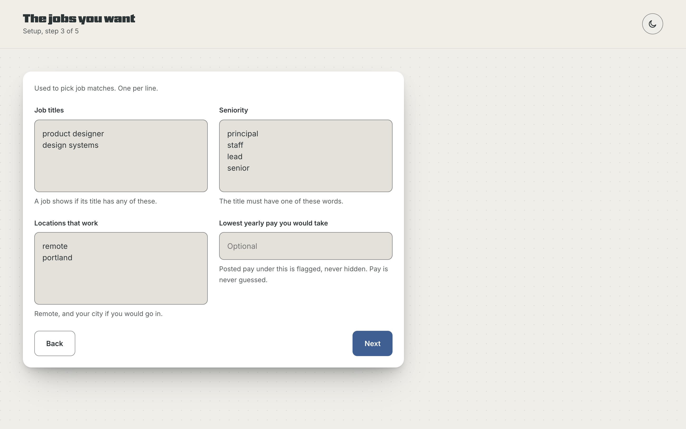</td>
<td>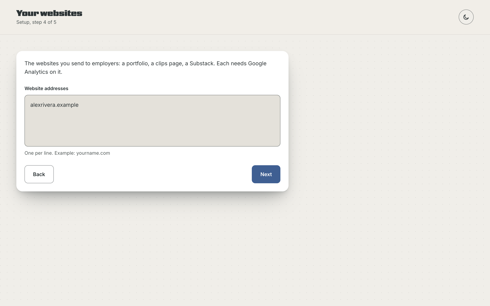</td>
</tr>
</table>

Your city is used to leave your own visits out. Your name and your one line about your work go
into the outreach notes.

## Connect Google Analytics

Settings walks you through seven steps, one at a time, with a button that opens each Google page.

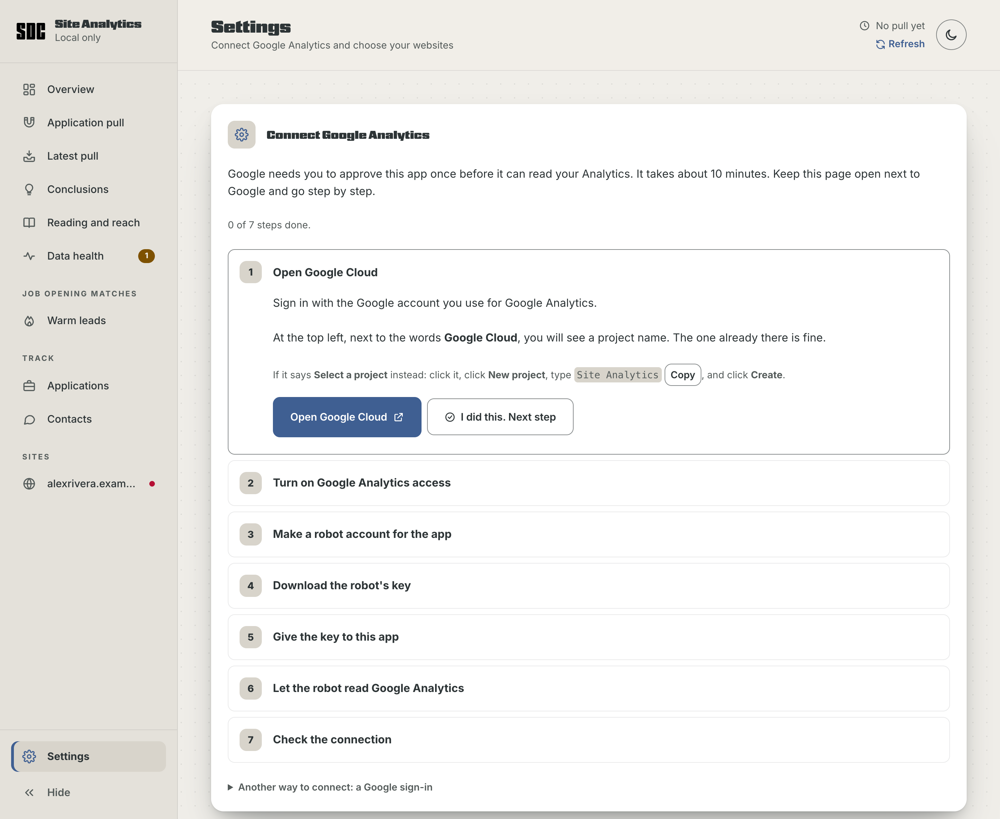

In short, you make a read-only "robot" login in Google Cloud (Google calls it a service account),
download its key, give the key to the app, and add the robot's email address as a **Viewer** in
Google Analytics. The key never expires and needs no app review by Google.

After that it runs on its own:

- The first pull starts right after the connection check.
- The app pulls again every 6 hours while it runs, and **Refresh** in the top bar pulls now.
- Job boards are checked once a day, and **Check now** on Warm leads checks now.

Then add the jobs you applied to under **Applications**, and the calls, messages and referrals
under **Contacts**. The more you log, the better the odds get. Applications can also be
imported from a CSV file.

## Try the demo first

To look around before connecting anything:

```sh
npm run demo
```

Then open [http://localhost:4341/](http://localhost:4341/). The demo uses made-up data, never
reads Google or any job board, and never touches your own data. Run `npm run demo:fresh` to see
the first-run setup on an empty install.

## Keep it running (Mac)

Automatic pulls happen only while the app is running. To have it start on its own at login and
run in the background:

```sh
scripts/login-item.sh install
```

`scripts/login-item.sh uninstall` turns that off, and `scripts/login-item.sh status` tells you if
it is on. It affects only your Mac account. The log is in `~/Library/Logs/site-analytics/`.

## Your data and privacy

- Everything you enter is saved as plain JSON files in `store/`, on your computer, with automatic
  backups in `store/.backups`. Your Google key is in `config/`. Both folders are readable only by
  your Mac account, are never served to the browser, and are left out of git.
- The app reaches out to the internet for these things only: Google Analytics (read-only), the
  public job boards of companies on your list, a job posting link you paste, and the fonts the
  page uses (Adobe Fonts and Google Fonts). There is no tracking and no account with this app.
- It never sends a message, email or connection request for you.
- The app never deploys anywhere. Do not put it on a web server: it holds the names of
  recruiters and the jobs you applied to.

## Security

- The server listens on this computer only (the loopback address) and refuses requests that name
  any other host.
- Only the app's own page files are served, from an exact allowlist. Data, keys and code are not.
- Other websites cannot use the app's API: the browser marks where each request comes from, and
  changes need a header another site cannot send.
- Anyone can send fake visits into Google Analytics, so every value from Google is escaped before
  it is shown, and only http and https links become links.
- Pages you paste a link to are fetched over https only, and local or private network addresses
  are refused.
- Every response carries a strict Content Security Policy and the usual browser protections.

One known limit: while the app runs, someone signed in to another account on the same Mac could
open it in their browser. If others use your Mac, keep that in mind.

When you are done with the setup, delete the downloaded key file from your Downloads folder. To
shut the robot out completely, delete its key in Google Cloud or remove it from Google Analytics.

## Update

With git: `cd ~/site-analytics && git pull`, then restart the app. Without git: download the new
ZIP, and copy your `store` and `config` folders into the new folder before you start it.

## Uninstall

Run `scripts/login-item.sh uninstall` if you turned on start at login, then delete the
`site-analytics` folder. In Google Cloud, delete the robot account, and in Google Analytics,
remove it from Property access management.

## For developers

No dependencies and no build step: Node's standard library on the server, plain JavaScript modules
in the page.

| File | What it does |
| --- | --- |
| `server.mjs` | Serves the page, stores data, holds the Google connection, runs the schedule |
| `lib/google.mjs` | Google sign-in (robot key or OAuth) and the Analytics API calls |
| `lib/pull.mjs` | One pull from Google Analytics, end to end |
| `lib/leads.mjs` | Reads the public job boards for Warm leads |
| `lib/job.mjs` | Reads one job posting for Add application |
| `js/engine.js` | Time zones, places, sources, filters and scoring, shared by server and page |
| `js/app.js`, `js/store.js`, `index.html`, `css/dash.css` | The page |
| `sdc.css` | The design system stylesheet (do not edit here) |
| `scripts/demo.mjs` | The demo, with made-up data |
| `scripts/screenshots.mjs` | Rebuilds `docs/screenshots` from the demo in headless Chrome |
| `scripts/login-item.sh` | Start at login on a Mac |

`npm run screenshots` needs Google Chrome and Node 22. The screenshots only ever come from the
demo, so they carry no personal information.
