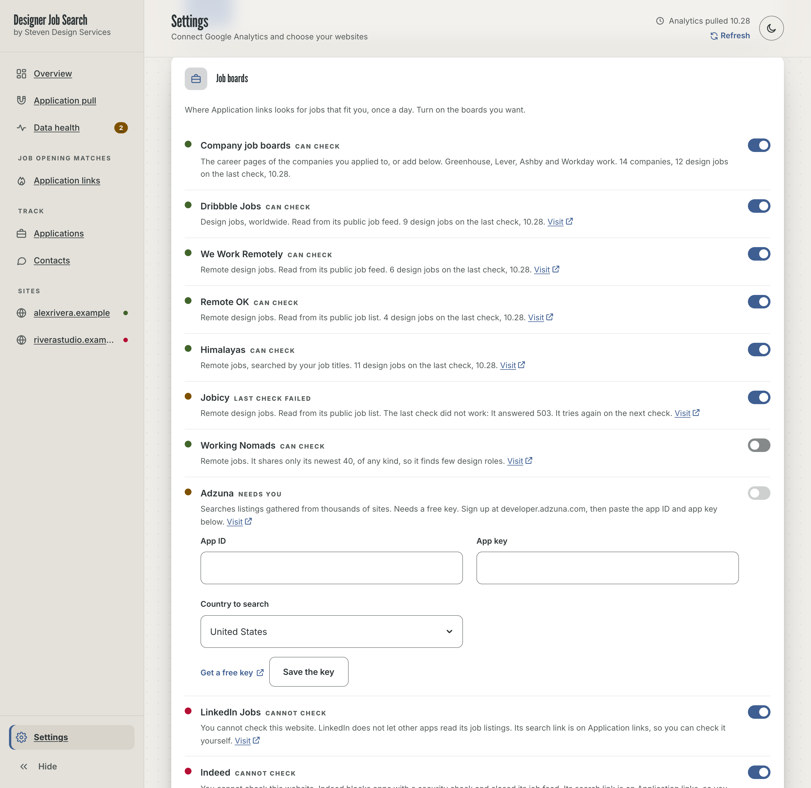
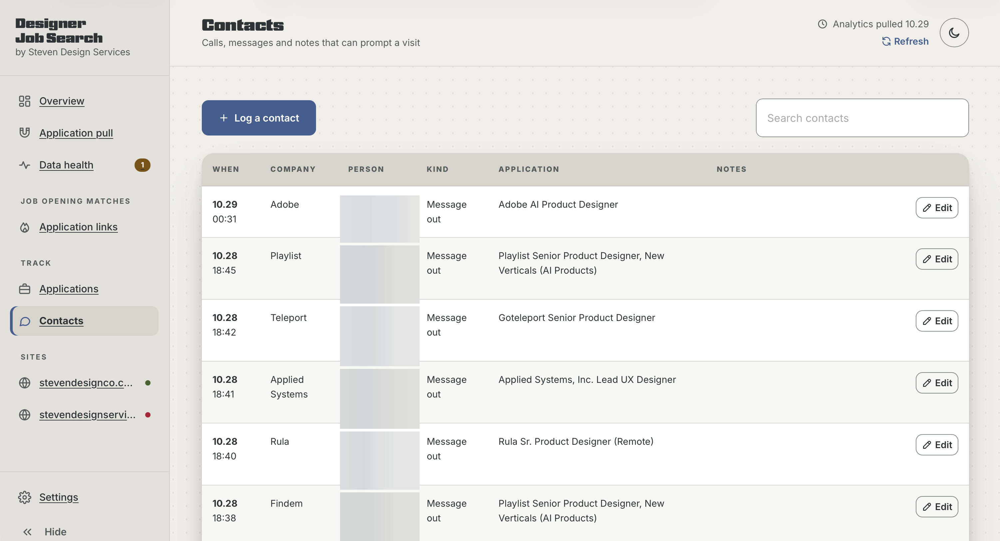
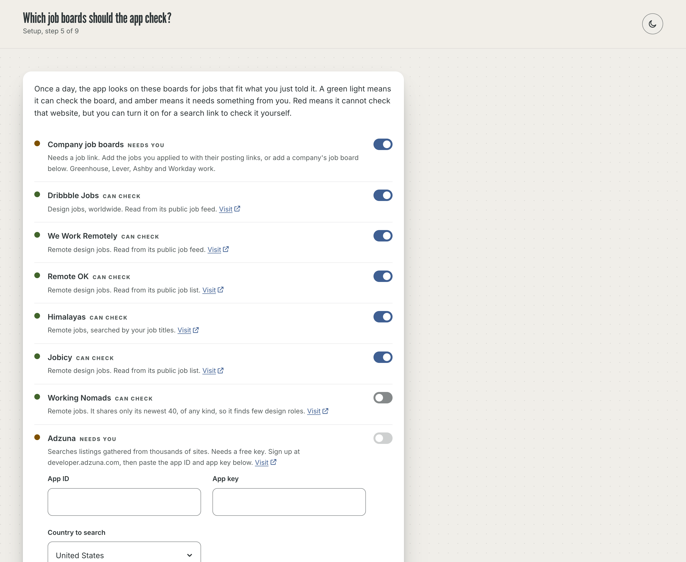
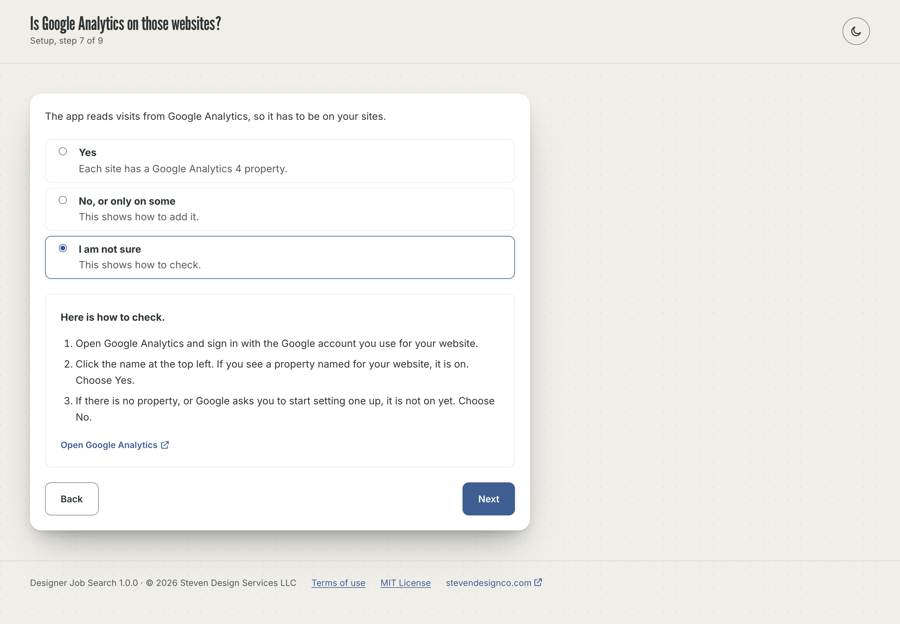
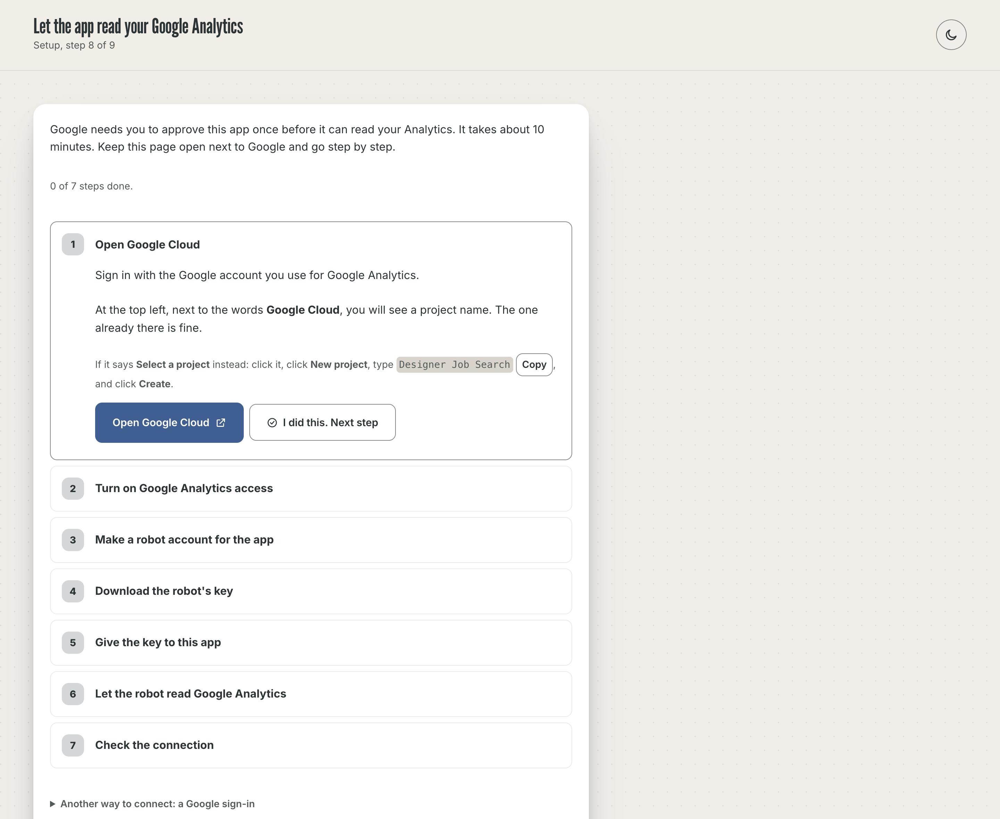
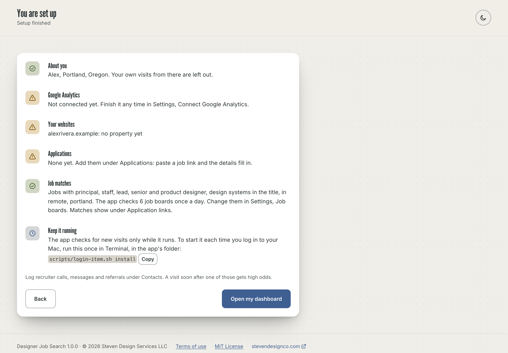

# Designer Job Search

By [Steven Design Services](https://stevendesignco.com).

A private dashboard for job seekers who send employers to their own website. It reads your
Google Analytics, matches each visit to the jobs you applied to, and estimates who looked and
when. It also finds open jobs that fit you and suggests someone to reach out to about each one.

It runs on your own computer. Your applications, contacts and notes never leave it.


The Overview, Application pull, Application links, Applications and Contacts screenshots come from
a real job search, with people's names and pay blurred out. The rest come from the built-in demo,
where every person, company and website is made up.

## What it does

**Application pull.** Each reader of your site, scored against your applications and contacts.
High odds means the visit came from inside an applicant system, or within hours of a call or a
referral, from a place that fits the job. Every name is an estimate: Google Analytics never names
a person or a company. **Last 7 days** narrows the list to the reads that came in or changed this
week.


**Application links,** under Job opening matches. Once a day the app checks the job boards you turn on:
the career pages of companies you applied to, and design job sites like Dribbble Jobs and We Work
Remotely. It keeps the jobs whose title, seniority, location and pay fit what you asked for, best
match first, and shows who you know there.


**Job boards** is where you choose which boards to check. Each one has a light: green means the
app can check it, amber means it needs something from you (a free key, or a better link), and red
means the app cannot check that website, with the reason. LinkedIn, Indeed and Glassdoor are red,
because they block apps, but turning one on puts a search link on Application links. The link
opens that site's search with your job titles already filled in, so you can check it yourself. You can add any board by its link, and
the app checks it right away.



**Reach out** finds people at the company on LinkedIn and writes a short note from your own
template. You copy the note and send it yourself. The app never sends anything for you.


Also in the app:

- **Overview:** your top three job matches, the latest reads, how readers arrived, which pages
  they read and where they read from.
- **Data health:** a check of each website's Google Analytics setup, with a link to each fix, and
  what the last pull read and left out (your own visits, machines and spam).
- **Applications** and **Contacts:** the lists the odds are scored against. Paste a job link and
  the company, role, requisition number and places fill in.
- Light and dark themes.

<table>
<tr>
<td></td>
<td></td>
</tr>
<tr>
<td></td>
<td></td>
</tr>
</table>

## What you need

- A Mac. The app is built and tested on macOS. It should run on Windows and Linux too, but the
  start at login script is Mac only.
- **Node.js 20 or later.** Free from [nodejs.org](https://nodejs.org) (pick the LTS version).
  There is nothing else to install.
- A website with **Google Analytics 4** on it, and a sign-in to that Google Analytics account.
  The app does not add Google Analytics to your site.
- About 15 minutes for the first setup.

## Install

### The easy way: ask Claude

If you use [Claude Code](https://claude.com/claude-code), paste this prompt and it does the
install for you. [INSTALL-WITH-CLAUDE.md](INSTALL-WITH-CLAUDE.md) explains each step.

```text
Install the Designer Job Search app for me from https://github.com/vandy1690/designer-job-search.

1. Check that Node.js 20 or later is installed (node -v). If it is missing or older, tell me how to install the LTS version from nodejs.org, and wait for me.
2. Put the app in a folder named designer-job-search in my home folder. Use git clone if git is installed. Otherwise download the ZIP of the main branch and unzip it there.
3. Read README.md and CLAUDE.md in that folder before doing anything else.
4. Start the app with "node server.mjs" from that folder, and open http://localhost:4340/ in my browser.
5. Ask me if the app should start on its own when I log in. Only if I say yes, run "scripts/login-item.sh install" (Mac only). If I say no, tell me the command to start it again later.
6. Then stop. The app walks me through the rest of the setup itself. Do not create Google Cloud projects, keys or accounts for me, and do not open, copy or change anything in the store or config folders.
```

### By hand

1. Install Node.js 20 or later from [nodejs.org](https://nodejs.org).
2. Get the app. Either run `git clone https://github.com/vandy1690/designer-job-search.git ~/designer-job-search`,
   or on GitHub click **Code**, then **Download ZIP**, unzip it, and move the folder to your home
   folder as `designer-job-search`.
3. Open Terminal and run:

   ```sh
   cd ~/designer-job-search
   node server.mjs
   ```

4. Open [http://localhost:4340/](http://localhost:4340/) in your browser.

Leave Terminal open while you use the app. To stop it, press Control C in Terminal.

## First run

The first time it opens, the app asks the questions it needs, one screen at a time, and sets
itself up:

1. Your first name, and one line about your work for outreach notes.
2. Your city and time zone. Your own visits from your city are left out.
3. The job titles and seniority you are looking for.
4. Where you would work, and the lowest pay you would take.
5. Which job boards to check.
6. The websites you send employers to.
7. Whether Google Analytics is on them, with help to add it or check.
8. Connecting Google Analytics, step by step.
9. Which Google Analytics property belongs to each website.
10. The jobs you have already applied to: paste job links, paste a CSV, or skip.

The last screen sums up what is set and what is left. Answers save as you go, so you can stop and
pick up later, even in a private or Incognito window. Everything can be changed later in Settings.

<table>
<tr>
<td></td>
<td></td>
</tr>
<tr>
<td></td>
<td></td>
</tr>
<tr>
<td></td>
<td></td>
</tr>
<tr>
<td></td>
<td></td>
</tr>
</table>

## Connect Google Analytics

Setup walks you through seven steps, one at a time, with a button that opens each Google page. If
you skip it during setup, the same steps are in Settings.

In short, you make a read-only "robot" login in Google Cloud (Google calls it a service account),
download its key, give the key to the app, and add the robot's email address as a **Viewer** in
Google Analytics. The key never expires and needs no app review by Google.

After that it runs on its own:

- The first pull starts right after the connection check.
- The app pulls again every 6 hours while it runs, and **Refresh** in the top bar pulls now.
- Job boards are checked once a day, and **Check now** on Application links checks now. Choose them in
  Settings, Job boards.

Then add the jobs you applied to under **Applications**, and the calls, messages and referrals
under **Contacts**. The more you log, the better the odds get. Applications can also be
imported from a CSV file.

## Try the demo first

To look around before connecting anything:

```sh
npm run demo
```

Then open [http://localhost:4341/](http://localhost:4341/). The demo uses made-up data, never
reads Google or any job board, and never touches your own data. Run `npm run demo:fresh` to see
the first-run setup on an empty install.

## Use it as a Mac app

To get Designer Job Search in its own window, with the SDS icon in your Dock:

```sh
npm run app
```

This builds `Designer Job Search.app` into Applications. It needs Apple's free developer tools
(if they are missing, run `xcode-select --install` first). Open the app from Applications,
Launchpad or Spotlight, and drag it to the Dock to keep it there.

- The app starts the local server for you and shows the dashboard. Job postings, LinkedIn and
  Google open in your normal browser.
- Closing the window keeps the app running, so automatic checks keep going. Quit it from the menu.
- The app runs the code in your `designer-job-search` folder, so updates need no rebuild. Rebuild
  only if you move that folder.
- If the folder is inside Documents, Desktop or Downloads, macOS asks once to let the app use
  files there. Click Allow.

## Keep it running (Mac)

Automatic pulls happen only while the app is running. To have it start on its own at login and
run in the background:

```sh
scripts/login-item.sh install
```

`scripts/login-item.sh uninstall` turns that off, and `scripts/login-item.sh status` tells you if
it is on. It affects only your Mac account. The log is in `~/Library/Logs/designer-job-search/`.

## Fonts

Headings use Nickel Gothic when your computer can load it, and League Gothic when it cannot.
League Gothic is free and comes with the app. Nickel Gothic is a paid typeface, so it is not
included. If your Adobe Fonts subscription has it, put your kit ID in Settings, Advanced, Adobe
Fonts kit, and add `localhost` to the kit's domains in Adobe Fonts. The rest of the text is Inter.

## Your data and privacy

- Everything you enter is saved as plain JSON files in `store/`, on your computer, with automatic
  backups in `store/.backups`. Your Google key is in `config/`. Both folders are readable only by
  your Mac account, are never served to the browser, and are left out of git.
- The app reaches out to the internet for these things only: Google Analytics (read-only), the
  job boards you turn on, a job posting or job board link you paste, the Inter font from
  Google Fonts, and your Adobe Fonts kit if you set one. There is no tracking and no account with
  this app.
- It never sends a message, email or connection request for you.
- It reads only what websites allow apps to read. It says who it is, follows each site's
  robots.txt, and stops at any block (a captcha, a robot check, a login wall). Sites that block
  apps, like LinkedIn, Indeed and Glassdoor, get a search link you open yourself instead.
- The app never deploys anywhere. Do not put it on a web server: it holds the names of
  recruiters and the jobs you applied to.

## Security

- The server listens on this computer only (the loopback address) and refuses requests that name
  any other host.
- Only the app's own page files are served, from an exact allowlist. Data, keys and code are not.
- Other websites cannot use the app's API: the browser marks where each request comes from, and
  changes need a header another site cannot send.
- Anyone can send fake visits into Google Analytics, so every value from Google is escaped before
  it is shown, and only http and https links become links.
- Pages you paste a link to are fetched over https only, and local or private network addresses
  are refused.
- Every response carries a strict Content Security Policy and the usual browser protections.

One known limit: while the app runs, someone signed in to another account on the same Mac could
open it in their browser. If others use your Mac, keep that in mind.

When you are done with the setup, delete the downloaded key file from your Downloads folder. To
shut the robot out completely, delete its key in Google Cloud or remove it from Google Analytics.

## Update

With git: `cd ~/designer-job-search && git pull`, then restart the app. Without git: download the new
ZIP, and copy your `store` and `config` folders into the new folder before you start it.

## Uninstall

Run `scripts/login-item.sh uninstall` if you turned on start at login, then delete the
`designer-job-search` folder. In Google Cloud, delete the robot account, and in Google Analytics,
remove it from Property access management.

## For developers

No dependencies and no build step: Node's standard library on the server, plain JavaScript modules
in the page.

| File | What it does |
| --- | --- |
| `server.mjs` | Serves the page, stores data, holds the Google connection, runs the schedule |
| `lib/google.mjs` | Google sign-in (robot key or OAuth) and the Analytics API calls |
| `lib/pull.mjs` | One pull from Google Analytics, end to end |
| `lib/leads.mjs` | The daily job check for Application links, and company job boards |
| `lib/feeds.mjs` | Job sites, feeds and boards you add; checks a board link |
| `js/boards.js` | The list of job boards and whether the app can check each one |
| `lib/job.mjs` | Reads one job posting for Add application |
| `js/engine.js` | Time zones, places, sources, filters and scoring, shared by server and page |
| `js/app.js`, `js/store.js`, `index.html`, `css/dash.css` | The page |
| `sdc.css` | The design system stylesheet (do not edit here) |
| `fonts/` | League Gothic, the free heading font, with its license |
| `scripts/demo.mjs` | The demo, with made-up data |
| `scripts/screenshots.mjs` | Rebuilds `docs/screenshots` from the demo in headless Chrome |
| `scripts/login-item.sh` | Start at login on a Mac |
| `mac/DesignerJobSearch.swift`, `scripts/make-app.mjs` | The Mac app and its build (`npm run app`) |
| `assets/` | The app icon (SDS mark) and its build (`npm run icon`) |
| `scripts/a11y.mjs` | Accessibility check, WCAG 2.2 AA with axe-core (`npm run a11y`) |
| `js/terms.js` | The terms of use and license the app shows (`npm run terms` copies them) |

`npm run screenshots` needs Google Chrome and Node 22. It rebuilds the demo screenshots: Reach out,
Data health, Job boards, the dark Overview and the setup screens. The five real screenshots are
kept by hand, with people's names and pay blurred, and the script leaves them alone.

## Terms of use

Using the app means agreeing to its [terms of use](TERMS.md): the first setup screen asks you to.
In short, matches are estimates, job listings come from other websites, you decide what you send
and to whom, and the app comes with no warranty or liability. The app's footer links to the terms
at any time.

## License

MIT, see [LICENSE](LICENSE). League Gothic is under the SIL Open Font License, see
[fonts/LEAGUE-GOTHIC-OFL.txt](fonts/LEAGUE-GOTHIC-OFL.txt).
